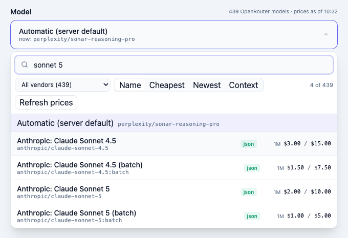

# @jash90/openrouter-model-picker

A searchable React picker over **every** model available on [OpenRouter](https://openrouter.ai), with live prices per 1M tokens on each row. Text search across id, name and vendor, vendor filter, sorting (name / cheapest / newest / context), keyboard navigation, dark mode, English and Polish labels.

No Tailwind, no state library, no OpenRouter API key required for the list. React 18+.



## Install

```bash
npm i @jash90/openrouter-model-picker
```

## Quick start

```tsx
import { OpenRouterModelPicker, useOpenRouterModels } from '@jash90/openrouter-model-picker';
import '@jash90/openrouter-model-picker/styles.css';

function ModelSelect() {
  const [model, setModel] = useState('');
  const { models, loading, refreshing, error, refresh, fetchedAt } = useOpenRouterModels();

  return (
    <OpenRouterModelPicker
      label="Model"
      models={models}
      loading={loading}
      refreshing={refreshing}
      error={error}
      onRefresh={refresh}
      fetchedAt={fetchedAt}
      value={model}
      onChange={setModel}
    />
  );
}
```

`useOpenRouterModels` calls `https://openrouter.ai/api/v1/models` directly (public, no key), keeps the list in a module-level cache for 10 minutes and shares one request between all pickers on the page.

## Loading models your own way

The component is *headless on the data side*: it only needs a `models` array. Any of these work:

```tsx
// 1. With an API key (returns only models the key can call)
useOpenRouterModels({ apiKey });

// 2. Through your backend proxy (auth, caching, rate limits stay server-side)
useOpenRouterModels({
  fetcher: () => fetch('/api/models').then((r) => r.json()).then(normalizeModelsResponse),
});

// 3. With TanStack Query / SWR — skip the hook entirely
const { data } = useQuery({ queryKey: ['models'], queryFn: () => fetchOpenRouterModels() });
<OpenRouterModelPicker models={data ?? []} … />
```

`normalizeModel`, `normalizeModelsResponse` and `fetchOpenRouterModels` are plain TypeScript and run on a server too (Node 18+), so an API can share the exact same `OpenRouterModel` shape and price normalization as the UI.

## Props

| Prop | Type | Description |
|---|---|---|
| `models` | `OpenRouterModel[]` | Required. Normalized list. |
| `value` / `onChange` | `string` / `(id: string) => void` | Selected model id. `""` means none / automatic. |
| `loading`, `refreshing`, `error` | | Passed through from your loader. |
| `onRefresh` | `() => void` | Renders a "Refresh prices" button. |
| `fetchedAt` | `string \| Date` | Shown as "prices as of 10:14" next to the label. |
| `defaultModelId` | `string` | Marked in the list; shown under the "automatic" entry. |
| `allowAuto` | `boolean` | Adds an "automatic" entry mapping to `""`. |
| `label` | `ReactNode` | Label above the control. |
| `compact` | `boolean` | Tighter paddings, no detail chips. |
| `labels` | `Partial<PickerLabels>` | Text overrides. `plLabels` ships Polish. |
| `vendorLabels` | `Record<string,string>` | Vendor id → display name. |
| `filter` | `(m) => boolean` | e.g. `m => m.supportsJsonMode`. |
| `initialSort` | `'name' \| 'cheapest' \| 'newest' \| 'context'` | |
| `theme` | `'light' \| 'dark'` | Force a theme (default follows the OS). |
| `disabled`, `className`, `id` | | |

### `OpenRouterModel`

```ts
{
  id: 'openai/gpt-5', name: 'OpenAI: GPT-5', vendor: 'openai', created, description,
  contextLength: 400000, maxCompletionTokens, inputModalities, outputModalities,
  supportedParameters, builtInWebSearch, supportsJsonMode, supportsReasoning,
  pricing: { promptPerM: 1.25, completionPerM: 10, perRequest: 0, perWebSearch: 0.01,
             reasoningPerM, cacheReadPerM, perImage, isFree: false }
}
```

Prices are USD per **1,000,000 tokens** (OpenRouter reports per-token strings; the library converts).

## Theming

All colours, radii and fonts are CSS custom properties on `.orp`. Override them on any ancestor:

```css
.orp {
  --orp-accent: #0ea5e9;
  --orp-bg: var(--card-bg);
  --orp-surface: var(--input-bg);
  --orp-border: var(--input-border);
  --orp-fg: var(--foreground);
  --orp-muted: var(--muted);
  --orp-radius: 12px;
}
```

Dark mode follows `prefers-color-scheme`; pass `theme="light" | "dark"` to force one. The full variable list is at the top of `styles.css`.

## Development

```bash
npm i
npm run dev        # demo at http://localhost:5173 against the live OpenRouter list
npm test
npm run build      # dist/index.js, dist/index.cjs, dist/index.d.ts, dist/styles.css
```

## License

MIT
